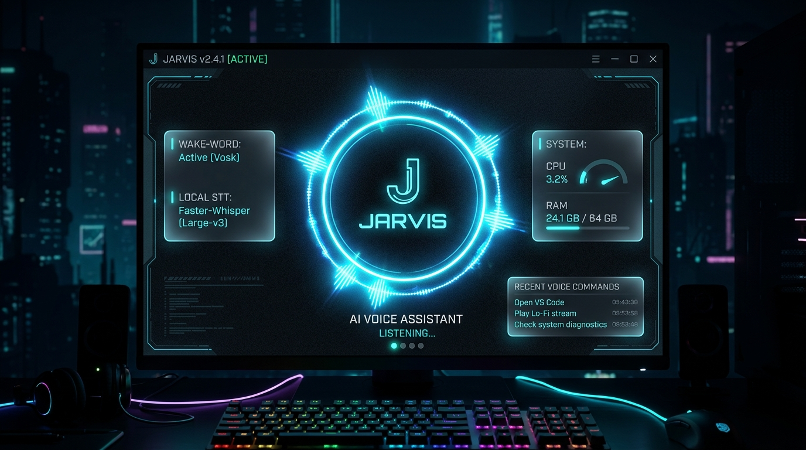

<div align="center">

# 👻 GHOST — Autonomous Neural Desktop OS & Remote Commander
### *One-Time QR Mobile Pairing, Encrypted Tunnel Control & Deep Windows OS Automation*

[](https://python.org/)
[](https://alphacephei.com/vosk/)
[](https://fastapi.tiangolo.com/)
[](./web/index.html)
[](./LICENSE)

<br />

<p align="center">
  <b>GHOST</b> is a next-generation cybernetic desktop operating system and remote control platform. Equipped with real-time Win32 automation, dual-stage speech recognition, and an encrypted wireless mobile bridge with instant One-Time QR pairing, GHOST enables complete hands-free control of your PC from anywhere in the world over 4G/5G.
</p>

[**Explore Capabilities**](#-core-capabilities) • [**Architecture**](#-speech--automation-pipeline) • [**Command Glossary**](#-supported-voice-commands) • [**Setup Guide**](#-setup--installation)

<br />



</div>

---

> 📖 **Comprehensive System Documentation & Technical Handbook**: For an exhaustive, chapter-by-chapter walkthrough of how JARVIS works, deep Win32 OS automation, the mobile wireless bridge, architecture diagrams, and technical interview Q&A, explore the [**`how_jarvis_works/`**](how_jarvis_works/README.md) handbook!

---

## 🌟 Core Capabilities

### 1. 🛡️ Dual-Stage Speech Engine (100% Private & Offline)
* **Stage 1 (Vosk Wake-Word)**: Continuously listens for the `"Jarvis"` activation key using an ultra-low CPU offline acoustic model. Zero cloud streaming while idling.
* **Stage 2 (Faster-Whisper STT)**: Once triggered, speech is transcribed locally via quantized Whisper (`large-v3` or `base.en`), providing high-accuracy transcription even in noisy environments without cloud subscription costs.

### 2. ⚡ Deep Windows OS Automation
* **Smart App Indexer**: Scans and indexes all installed Windows applications (VS Code, Chrome, Spotify, Figma) for instant zero-latency voice launching.
* **"Work Mode" Routine**: A single phrase (*"Start work mode"*) simultaneously opens your development environment: VS Code, terminal windows, Chrome documentation tabs, and background audio.
* **Native WhatsApp Desktop Routing**: Prepares and sends messages through native Windows messaging apps.

### 3. 🌐 Media & Web Execution
* **Instant YouTube Automation**: Commands like *"Play lo-fi music on YouTube"* automatically query the YouTube search engine and launch playback instantly.
* **System Telemetry & Diagnostics**: Query CPU load, memory utilization, network latency, and weather reports through voice.

### 4. 🌌 Cyber-Ring Glassmorphic HUD
* **Dynamic Waveform Visualization**: Visual ring pulses in sync with real-time mic amplitude, giving clear visual cues for *Listening*, *Thinking*, *Speaking*, and *Standby*.
* **Minimal Resource Footprint**: Built with hardware-accelerated PyQt6 shaders that consume less than 3% background CPU.

---

## 🏗️ Speech & Automation Pipeline

```text
[ Microphone Stream ]
         │
         ▼
[ Vosk Lightweight Offline Engine ] ──► (Waiting for "Jarvis"...)
         │ (Wake Word Detected!)
         ▼
[ Cyber-Ring HUD Activates ("Listening...") ]
         │
         ▼
[ Faster-Whisper Local Transcription ]
         │
         ▼
[ NLP Intent Matcher & Rule Engine ]
         │
    ┌────┴───────────────────────────┐
    ▼                                ▼
[ OS & Desktop Automation ]   [ Web & Media Automation ]
(Launch VS Code, System Info) (YouTube Streams, Searches)
         │                                │
         └──────────────┬─────────────────┘
                        ▼
            [ Natural Voice Response & UI Log ]
```

---

## 🗣️ Supported Voice Commands

| Category | Example Voice Command | Action Executed |
| :--- | :--- | :--- |
| **Workspace** | *"Start work mode"* | Opens VS Code, Terminal, Spotify, and Chrome |
| **Media** | *"Play synthwave on YouTube"* | Finds & plays top-ranked track directly |
| **System** | *"System diagnostics"* | Reads current CPU %, RAM usage, and battery |
| **Communication** | *"Open WhatsApp and message Alex"* | Dispatches chat window with pre-filled prompt |
| **Standby** | *"Go to sleep"* | Silences listening and minimizes to system tray |

---

## 🛠️ Tech Stack & Dependencies

* **Language**: Python 3.10+
* **Speech-to-Text**: Faster-Whisper, Vosk Speech Recognition
* **Text-to-Speech**: pyttsx3 / Edge-TTS
* **Desktop GUI**: PyQt6 (QML & Shader support)
* **OS Interactivity**: `pyautogui`, `psutil`, `subprocess`

---

## 🚀 Setup & Installation

### 1. Clone the Repository
```bash
git clone https://github.com/Ahmad-Haassan/JARVIS-Voice-Agent.git
cd JARVIS-Voice-Agent
```

### 2. Create Virtual Environment & Install Dependencies
```bash
python -m venv venv
venv\Scripts\activate

pip install -r requirements.txt
```

### 3. Download Offline Acoustic Model
Download the small English model from [Vosk Models](https://alphacephei.com/vosk/models) (e.g., `vosk-model-small-en-us-0.15`) and place it inside `./model/`.

### 4. Run JARVIS
```bash
python main.py
```
Say **"Jarvis"** to wake the assistant, then give any command!

---

## 📬 Connect & Author

- **Developer**: Ahmad Hassan
- **GitHub**: [@Ahmad-Haassan](https://github.com/Ahmad-Haassan)
- **Email**: [ahmad.hassan.dev@gmail.com](mailto:ahmad.hassan.dev@gmail.com)

---

## 📄 License

This project is licensed under the [MIT License](./LICENSE).
