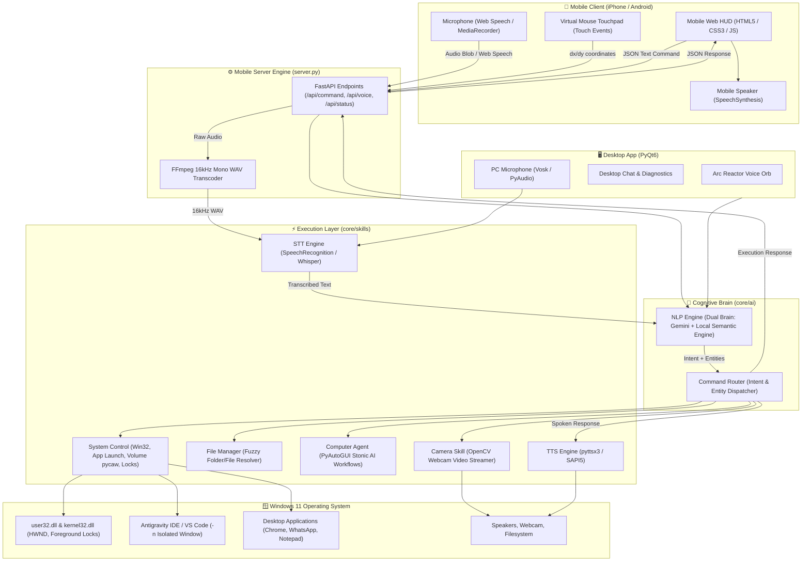

# Chapter 2: System Architecture & Data Flow

## 1. High-Level Architecture Diagram

The following Mermaid diagram illustrates the complete topology of JARVIS across the Desktop and Mobile environments:

---

## 2. The Four Architectural Subsystems

### Subsystem 1: Input & Ingestion Layer
JARVIS can receive commands from three distinct channels:
1. **Desktop Voice Channel**: Uses `core/voice/wake_word.py` running an offline **Vosk** acoustic neural network in a background thread. When the keyword *"Jarvis"* is recognized, it pauses the wake detector, emits a signal to the PyQt6 GUI, and activates `core/voice/stt.py` to record the spoken command.
2. **Mobile Voice Channel**: In `web/index.html`, the user taps the Speak button. The client uses the HTML5 `SpeechRecognition` API or `MediaRecorder`. If audio is recorded, it posts a binary multipart payload to `/api/voice`. In `server.py`, `ffmpeg` converts the audio to 16kHz mono PCM WAV, which `speech_recognition` transcribes via Google STT.
3. **Text / Touchpad Channel**: Direct JSON requests sent via HTTP POST to `/api/command`, `/api/computer/mouse/move`, or `/api/computer/keyboard/type`.

### Subsystem 2: Cognitive & Routing Layer (`core/ai/`)
1. **`nlp_engine.py`**:
   - Takes raw string input (e.g., *"Open dsa folder in antigravity and give prompt solve assignment 3"*).
   - Normalizes text (lowercase, whitespace trimming, typo correction like `forlder` -> `folder`).
   - Evaluates whether to dispatch to **Google Gemini** (for open-ended conversational questions) or the **Deterministic Semantic Parser** (for system, window, and application controls).
   - Returns a structured dictionary containing:
     - `intent`: (e.g. `open_in`, `volume_control`, `camera`, `work_mode`)
     - `entities`: (e.g. `{"target": "dsa", "app": "antigravity", "prompt": "solve assignment 3"}`)
     - `response`: Pre-composed polite spoken confirmation.
2. **`command_router.py`**:
   - Acts as the central traffic controller.
   - Inspects the `intent` and dispatches to the appropriate skill handler in `core/skills/`.

### Subsystem 3: Execution & Skill Layer (`core/skills/`)
- **`system_control.py`**: Contains low-level Windows API bindings (`ctypes.windll.user32`, `kernel32`), `pycaw` for hardware audio, window enumeration, application launching, and screen capturing.
- **`file_manager.py`**: Understands natural language folder names (*"my downloads"*, *"dsa"*, *"uni assignments"*) and performs multi-tiered fuzzy search up to 3 directory depths.
- **`computer_agent.py`**: Autonomous mouse & keyboard driver utilizing `pyautogui` for window snapping, auto-typing into active editors, and multi-step desktop workflows.
- **`camera.py`**: Direct OpenCV hardware capture with MJPEG stream generator for zero-latency video streaming to mobile.

### Subsystem 4: Presentation & Feedback Layer
- **Desktop HUD (`gui/main_window.py`)**: PyQt6 application with dark mode cyber aesthetics, glowing Arc Reactor animation, active window metrics, and settings drawer.
- **Mobile Web HUD (`server.py` + `web/index.html`)**: Glassmorphic responsive interface optimized for iOS Safari and Android Chrome, featuring **Speak Mode**, **Text Mode**, and **Controls Mode**.

---

## 3. End-to-End Execution Trace: A Real Command

Here is the exact millisecond-by-millisecond trace of what happens when you say:
> **"Open testing folder in antigravity, write rules of cricket"** from your phone:

| Time | Component | Action |
|---|---|---|
| **0 ms** | Phone Browser | User taps Speak button. Phone microphone captures voice audio. |
| **800 ms**| Phone Browser | Silence detected. Audio blob posted to `POST /api/voice`. |
| **850 ms**| `server.py` | `ffmpeg` converts webm/mp4 audio blob to 16kHz mono WAV in 40ms. |
| **950 ms**| `core/voice/stt` | Google Speech API transcribes audio: *"Open testing folder in antigravity, write rules of cricket"*. |
| **960 ms**| `nlp_engine.py` | Regex parser matches `open_in` pattern; extracts `target='testing'`, `app='antigravity'`, `prompt='write rules of cricket'`. |
| **970 ms**| `command_router.py` | Calls `file_manager.resolve_folder('testing')` -> resolves to `C:\Users\Ahmad\OneDrive\Desktop\testing`. |
| **980 ms**| `system_control.py` | Launches `antigravity-ide.cmd -n "C:\...\testing"` in a **brand new window** (`-n`). |
| **990 ms**| `server.py` | Returns HTTP 200 JSON to phone with message: *"Opened testing in antigravity and dispatched prompt"*. Phone reads this out loud via mobile speaker. |
| **1200 ms**| Injector Thread | Background thread polls for window title containing `'testing'`. |
| **2100 ms**| Injector Thread | Target window appears. Thread attaches input via `AttachThreadInput` & `SetForegroundWindow`. |
| **2300 ms**| Injector Thread | Clicks center of new window to activate, sends `Ctrl + L` to focus Agent Chat. |
| **2900 ms**| Injector Thread | Pastes prompt (`Ctrl + V`) from clipboard and presses `Enter`. |
| **3000 ms**| Antigravity AI | AI Agent in the separate Antigravity window begins coding autonomously! |
